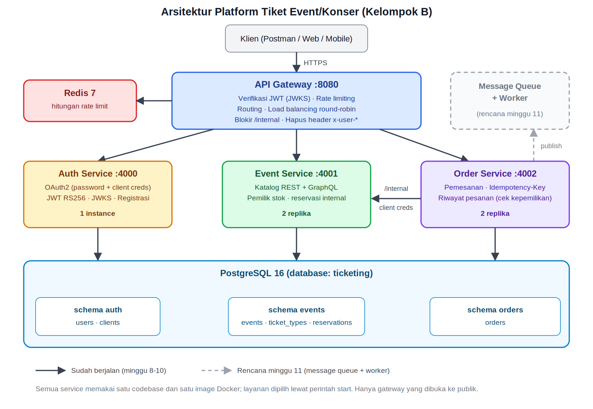
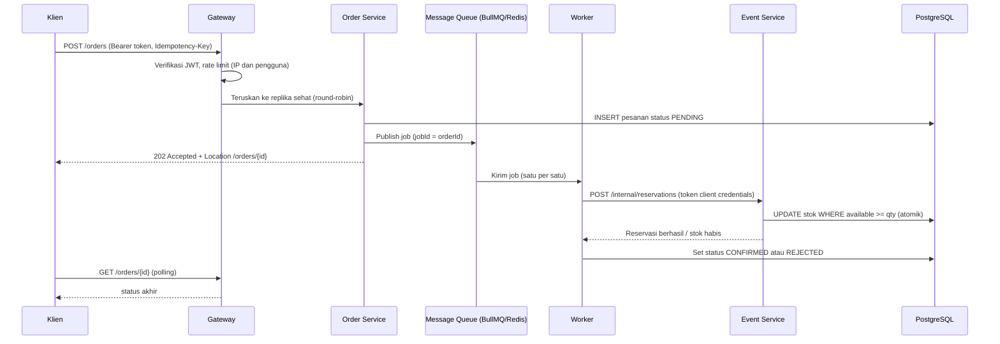

# Platform Tiket Event/Konser (Kelompok B)

Sistem tiket berbasis microservices untuk proyek lintas mata kuliah **Web Service x Software Testing**.

Status: **progress sampai minggu 11** (keamanan OAuth2, API Gateway, service discovery, load balancing, message queue + worker, anti tiket ganda). Tersedia juga antarmuka web sederhana di `http://localhost:8080/`.

## Daftar isi

1. [Arsitektur](#arsitektur)
2. [Teknologi](#teknologi)
3. [Menjalankan dengan Docker](#menjalankan-dengan-docker)
4. [Cara autentikasi](#cara-autentikasi)
5. [Daftar endpoint](#daftar-endpoint)
6. [Data awal untuk pengujian](#data-awal-untuk-pengujian)
7. [Memeriksa database](#memeriksa-database)
8. [Daftar environment variable](#daftar-environment-variable)
9. [Deployment](#deployment-render--neon--upstash)
10. [Keamanan](#keamanan-ringkasan-untuk-laporan-44)
11. [Message queue dan worker](#message-queue-dan-worker-minggu-11)
12. [Service discovery dan load balancing](#service-discovery-dan-load-balancing-minggu-10)
13. [Antarmuka web](#antarmuka-web)
14. [Menjalankan test](#menjalankan-test)
15. [Pemecahan masalah](#pemecahan-masalah)
16. [Struktur proyek](#struktur-proyek)
17. [Rencana berikutnya](#rencana-berikutnya)

## Arsitektur



*Versi vektor: [`docs/arsitektur.svg`](docs/arsitektur.svg). Garis putus-putus adalah jalur asinkron lewat message queue.*

| Service | Port | Instance | Tugas |
|---|---|---|---|
| gateway | 8080 | 1 | Satu-satunya pintu masuk publik. Verifikasi JWT, rate limit, routing, load balancing, blokir `/internal` |
| auth-service | 4000 | 1 | Authorization Server OAuth2 (password dan client credentials), JWKS, registrasi |
| event-service | 4001 | 2 replika | Katalog event (REST dan GraphQL), pemilik stok tiket, endpoint reservasi internal |
| order-service | 4002 | 2 replika | Menerima pesanan (`202 PENDING`), idempotensi, memasukkan pesanan ke antrian, riwayat pesanan |
| worker | - (opsional `/health`) | 1 | Konsumen antrian: memanggil reservasi stok ke event-service, menetapkan status akhir, retry, sweeper |
| postgres | 5432 | 1 | Database (schema `auth`, `events`, `orders`), tidak dibuka ke luar |
| redis | 6379 | 1 | Hitungan rate limit gateway dan message queue (BullMQ), tidak dibuka ke luar |

Semua service memakai satu codebase dan satu image Docker; service dipilih lewat perintah start (`node src/<service>.js`).

### Alur pemesanan tiket (minggu 11: asinkron lewat message queue)



Mengapa asinkron: saat penjualan dibuka, ribuan request tiba bersamaan. Order Service hanya menulis satu baris dan satu pesan antrian (cepat), sedangkan pemrosesan stok yang berat dilakukan Worker dengan laju terkendali, sehingga Event Service dan database tidak jebol. Tiket tidak terjual ganda karena pengurangan stok atomik di database dan reservasi berkunci `orderId`, jadi job yang terkirim dua kali atau di-retry tidak mengurangi stok dua kali.

**Ketahanan (failure handling)**

| Kondisi | Perilaku |
|---|---|
| Event Service sementara mati / timeout | Job gagal lalu di-retry otomatis dengan exponential backoff (default 5 percobaan: 2, 4, 8, 16 detik). Pesanan tetap `PENDING`. |
| Semua percobaan gagal | Job masuk *dead-letter* (set `failed` BullMQ, 1000 terakhir disimpan) dan pesanan ditandai `REJECTED` dengan `reason=PROCESSING_FAILED`. |
| Redis mati tepat saat publish | Pesanan sudah tersimpan `PENDING`; Order Service tetap membalas `202`. Sweeper Worker mengantrikan ulang pesanan `PENDING` yang lebih tua dari 60 detik (cek tiap 30 detik). |
| Pesan terkirim dua kali / job diproses ulang | Aman: Worker melewati pesanan yang sudah bukan `PENDING`, dan reservasi stok idempoten. |
| Worker dimatikan (SIGTERM) | Job yang sedang berjalan diselesaikan dulu; job lain tetap di antrian (Redis memakai AOF di Compose). |

Batasan yang diketahui (untuk dibahas di laporan): jika Event Service sempat berhasil mereservasi tetapi responsnya hilang lalu semua percobaan gagal, stok bisa tertahan untuk pesanan `REJECTED` (kesalahan ke arah "kurang jual", bukan oversell). Endpoint pelepasan reservasi belum dibuat.

## Teknologi

| Komponen | Teknologi |
|---|---|
| Bahasa / runtime | JavaScript, Node.js 22 (ES Modules) |
| Framework HTTP | Express 4 |
| Database | PostgreSQL 16 (schema: `auth`, `events`, `orders`) |
| Cache / penyimpanan rate limit | Redis 7 |
| Message queue | BullMQ (di atas Redis 7): retry, backoff, dead-letter |
| Autentikasi | OAuth2, JWT RS256 (library `jose`), hashing `bcryptjs` |
| Validasi input | `zod` |
| Protokol | REST dan GraphQL (`graphql`) |
| Keamanan HTTP | `helmet`, `cors`, `express-rate-limit` + `rate-limit-redis` |
| Kontainerisasi | Docker dan Docker Compose |
| Deployment | Render (service), Neon (Postgres), Upstash (Redis) |

## Menjalankan dengan Docker

Prasyarat: Docker Desktop (Compose v2) yang sudah berstatus **Engine running**. Node.js 20+ hanya dibutuhkan untuk smoke test dan `npm run gen:jwk`. Port **8080** harus kosong.

```bash
docker compose up --build        # gateway di http://localhost:8080
docker compose ps                # event-service dan order-service masing-masing 2 replika
docker compose down -v           # hentikan dan hapus data
```

Tunggu sekitar 30-60 detik sampai `auth-service` dan `gateway` berstatus `healthy`. Tabel dan data contoh dibuat otomatis; database tidak perlu dibuat manual.

Tanpa file `.env`, nilai default pengembangan dipakai (lihat `.env.example`). **Ganti semua secret sebelum deployment.**

Untuk hasil yang bersih sebelum pengujian, jalankan `docker compose down -v` lalu `docker compose up --build`. Smoke test meninggalkan user dan event baru, sehingga mengulanginya tanpa `down -v` dapat mengubah hasil beberapa pemeriksaan.

### Smoke test end-to-end

Butuh Node 20+ di mesin host.

```bash
node scripts/smoke.mjs                       # melawan http://localhost:8080
BASE_URL=https://url-deploy node scripts/smoke.mjs
```

Smoke test memeriksa autentikasi, otorisasi, GraphQL, load balancing, 30 pemesanan bersamaan terhadap stok 10 (diterima `202`, lalu menunggu Worker: tepat 10 `CONFIRMED`, 20 `REJECTED`), idempotensi, dan rate limit.

### Tanpa Docker (pengembangan)

Jalankan Postgres dan Redis sendiri, isi variabel dari `.env.example` (dengan `DISCOVERY=static`), lalu `npm ci` dan jalankan `node src/auth-service.js`, `event-service.js`, `order-service.js`, `gateway.js` (masing-masing proses terpisah, `PORT` berbeda).

### Catatan Windows / PowerShell

Contoh `curl` di dokumen ini memakai sintaks bash. Di PowerShell, gunakan `curl.exe` (bukan `curl`), `Invoke-RestMethod`, atau Postman.

## Cara autentikasi

Akun admin awal dibuat dari `ADMIN_EMAIL` dan `ADMIN_PASSWORD` (default lokal: `admin@example.com` / `ChangeMe123!`). Pengguna biasa mendaftar sendiri.

```bash
# 1. Daftar
curl -X POST localhost:8080/auth/register -H 'content-type: application/json' \
  -d '{"email":"budi@example.com","password":"Password123!","name":"Budi"}'

# 2. Minta token (OAuth2 password grant, client publik "ticketing-web")
curl -X POST localhost:8080/oauth/token \
  -d grant_type=password -d client_id=ticketing-web \
  -d username=budi@example.com -d password='Password123!'
# -> {"access_token":"eyJ...","token_type":"Bearer","expires_in":900,"scope":"events:read orders:read orders:write"}

# 3. Pakai token
TOKEN=eyJ...
curl localhost:8080/events?city=Jakarta -H "authorization: Bearer $TOKEN"

# 4. Pesan tiket (Idempotency-Key opsional tetapi disarankan)
curl -X POST localhost:8080/orders -H "authorization: Bearer $TOKEN" \
  -H 'content-type: application/json' -H 'Idempotency-Key: pesanan-001' \
  -d '{"ticketTypeId":"<id dari /events>","quantity":2}'

# 5. GraphQL
curl -X POST localhost:8080/graphql -H "authorization: Bearer $TOKEN" -H 'content-type: application/json' \
  -d '{"query":"{ events(limit:3){ items{ name startsAt minPrice } } }"}'
```

Versi PowerShell:

```powershell
$body = @{ email="budi@example.com"; password="Password123!"; name="Budi" } | ConvertTo-Json
Invoke-RestMethod -Method Post -Uri http://localhost:8080/auth/register -ContentType "application/json" -Body $body

$tok = Invoke-RestMethod -Method Post -Uri http://localhost:8080/oauth/token `
  -Body @{ grant_type="password"; client_id="ticketing-web"; username="budi@example.com"; password="Password123!" }
$H = @{ Authorization = "Bearer $($tok.access_token)" }
Invoke-RestMethod http://localhost:8080/events -Headers $H
```

Token berumur 15 menit (`ACCESS_TOKEN_TTL_SECONDS`), ditandatangani RS256. Kunci publik ada di `GET /.well-known/jwks.json`.

| Role | Scope |
|---|---|
| user | `events:read`, `orders:read`, `orders:write` |
| admin | semua scope user + `events:write` |
| service (order-service) | `inventory:write`, `inventory:read` (hanya untuk panggilan internal) |

## Daftar endpoint

Spesifikasi lengkap: [`docs/openapi.yaml`](docs/openapi.yaml). Skema GraphQL beserta contoh query/mutation: [`docs/schema.graphql`](docs/schema.graphql).

| Metode | Path | Akses | Keterangan |
|---|---|---|---|
| GET | `/health` | publik | Status gateway (minimal, tanpa detail internal) |
| POST | `/auth/register` | publik | Daftar akun |
| POST | `/oauth/token` | publik | Minta token (OAuth2) |
| GET | `/.well-known/jwks.json` | publik | Kunci publik JWT |
| GET | `/auth/me` | token | Identitas dari token |
| GET | `/admin/upstreams` | admin | Daftar replika upstream dan kesehatannya (bukti service discovery) |
| GET | `/events` | `events:read` | Daftar event (filter `q`, `city`, `category`, `status`, `onlyAvailable`, `limit`, `offset`) |
| GET | `/events/{id}` | `events:read` | Detail event dan jenis tiket |
| POST | `/events` | admin, `events:write` | Buat event |
| POST | `/graphql` | `events:read` | Katalog via GraphQL; mutation `createEvent` khusus admin |
| POST | `/orders` | `orders:write` | Pesan tiket. Asinkron: `202` + status `PENDING`; pantau lewat `Location` |
| GET | `/orders` | `orders:read` | Daftar pesanan sendiri |
| GET | `/orders/{id}` | `orders:read` | Detail pesanan dan status akhir `CONFIRMED`/`REJECTED` (pemilik atau admin) |

Endpoint `/internal/*` (reservasi stok) sengaja tidak dapat dijangkau lewat gateway (404) dan hanya menerima token `client_credentials`.

Format error seragam: `{"error":{"code":"...","message":"...","details":[...],"requestId":"..."}}`. Error pada `/oauth/token` mengikuti RFC 6749 (`error`, `error_description`).

**Batas yang berlaku** (default, dapat diubah lewat env; respons `429` selalu disertai header `Retry-After`):

| Target | Batas |
|---|---|
| Global | 300/menit per IP |
| `/oauth/token` | 20 percobaan **gagal** per 5 menit per IP |
| `/auth/register` | 20 per 5 menit per IP |
| `/events` | 120/menit per pengguna |
| `/graphql` | 60/menit per pengguna |
| `POST /orders` | 10/menit per pengguna |
| `GET /orders` | 60/menit per pengguna |

Batas lain: maksimum 4 tiket per pesanan; GraphQL kedalaman maksimum 5 dan field maksimum 100 (alias dihitung); `limit` halaman maksimum 50; body maksimum 100 KB di gateway.

## Data awal untuk pengujian

Event Service mengisi 5 event contoh saat pertama kali jalan, termasuk **"Konser Uji Beban (stok terbatas)"** dengan stok 10 tiket untuk menguji pemesanan bersamaan. Penguji dapat membuat event baru lewat akun admin (`POST /events`) untuk skenario lain.

## Memeriksa database

Postgres tidak dibuka ke luar Docker. Periksa lewat container:

```bash
docker compose exec postgres psql -U ticketing -d ticketing
```

| Schema | Tabel |
|---|---|
| `auth` | `users`, `clients` |
| `events` | `events`, `ticket_types`, `reservations` |
| `orders` | `orders` |

```sql
\dt auth.*
\dt events.*
\dt orders.*
SELECT * FROM events.ticket_types;
SELECT * FROM orders.orders ORDER BY created_at DESC LIMIT 10;
\q
```

## Daftar environment variable

Lengkap dengan placeholder di [`.env.example`](.env.example). Variabel wajib per service:

| Service | Wajib |
|---|---|
| gateway | `AUTH_JWKS_URL`, `AUTH_SERVICE_URLS`, `EVENT_SERVICE_URLS`, `ORDER_SERVICE_URLS`, `DISCOVERY`; opsional `REDIS_URL`, `TRUST_PROXY`, `CORS_ORIGINS`, `RATE_LIMIT_*` |
| auth-service | `DATABASE_URL`, `ORDER_SERVICE_CLIENT_SECRET`, `ADMIN_EMAIL`, `ADMIN_PASSWORD`; opsional `JWT_PRIVATE_JWK_B64`, `ACCESS_TOKEN_TTL_SECONDS` |
| event-service | `DATABASE_URL`, `AUTH_JWKS_URL` |
| order-service | `DATABASE_URL`, `AUTH_JWKS_URL`, `REDIS_URL` |
| worker | `DATABASE_URL`, `REDIS_URL`, `AUTH_SERVICE_URLS`, `EVENT_SERVICE_URLS`, `ORDER_SERVICE_CLIENT_SECRET`; opsional `WORKER_CONCURRENCY`, `ORDER_JOB_ATTEMPTS`, `ORDER_JOB_BACKOFF_MS`, `ORDER_SWEEP_INTERVAL_MS`, `ORDER_STALE_SECONDS` |

Semua service: `ENFORCE_SECRETS=true` membuat service menolak start jika secret kosong, terlalu pendek, atau masih default. **Wajib aktif pada deployment publik.** Buat kunci JWT dengan `npm run gen:jwk`.

## Deployment (Render + Neon + Upstash)

1. Neon: buat database Postgres, salin connection string ke `DATABASE_URL` (tambahkan `?sslmode=require`; tabel dibuat otomatis saat service pertama kali start).
2. Upstash (atau Redis lain): salin URL `rediss://...` ke `REDIS_URL` **gateway, order-service, dan worker** (satu Redis yang sama). Message queue wajib Redis; Upstash gratis memiliki batas jumlah perintah harian, jadi pantau pemakaian dan jangan menjalankan uji beban panjang tanpa memeriksa kuota. Bila memakai Redis sendiri, atur `maxmemory-policy noeviction`.
3. Render: buat 4 Web Service dari repo yang sama (build `npm install`, start `node src/<service>.js`), ditambah **worker** (`node src/worker.js`) sebagai *Background Worker*. Jika memakai tier gratis (tidak ada Background Worker), buat sebagai Web Service: worker membuka `GET /health` otomatis bila `PORT` diatur; pantau URL itu dengan layanan ping (mis. UptimeRobot) agar tidak tidur, karena worker yang tidur berarti pesanan menumpuk `PENDING`. Isi `DISCOVERY=static` dan URL publik antarlayanan (mis. `EVENT_SERVICE_URLS=https://event-service-xxxx.onrender.com`). Isi `TRUST_PROXY=1` pada gateway, `ENFORCE_SECRETS=true` di semua service, dan `JWT_PRIVATE_JWK_B64` (hasil `npm run gen:jwk`) di auth-service. Ganti `ADMIN_PASSWORD` dan `ORDER_SERVICE_CLIENT_SECRET`.
4. Hanya URL gateway yang diberikan kepada kelompok penguji.

**Catatan untuk penguji:** pada tier gratis Render, service tidur setelah tidak aktif sehingga request pertama bisa lambat (cold start). Panggil `GET /health` beberapa kali sebelum pengujian performa.

## Keamanan (ringkasan untuk laporan 4.4)

- OAuth2: password grant untuk pengguna (client publik), client credentials untuk antarlayanan. JWT RS256, `iss`, `aud`, `exp` diverifikasi; kunci diambil dari JWKS.
- Zero trust antarlayanan: gateway memeriksa token, dan setiap service memeriksanya lagi. Header identitas dari klien tidak dipercaya.
- Least privilege: scope per role; endpoint `/internal` hanya untuk role `service` berscope `inventory:write` dan diblokir di gateway.
- Rate limiting berlapis (IP global, percobaan login gagal per IP, pengguna untuk events/GraphQL/order) dengan Redis agar konsisten antar replika. Jika Redis mati, gateway fail-open demi ketersediaan.
- `/health` publik minimal; detail replika hanya di `/admin/upstreams` (admin). `ENFORCE_SECRETS=true` mencegah secret default dipakai di produksi.
- Grant `password` dipakai untuk client publik demi kesederhanaan; OAuth 2.1 sudah menghapusnya (produksi: Authorization Code + PKCE). Dibahas di laporan 4.4.
- Password di-hash bcrypt; login tidak membocorkan keberadaan akun (pesan sama, waktu konstan).
- Otorisasi tingkat objek: pesanan hanya dapat dibaca pemilik atau admin (pengguna lain mendapat 404).
- Validasi input dengan zod di semua endpoint; query SQL berparameter; error 500 tidak membocorkan detail internal.
- GraphQL: batas kedalaman dan jumlah field, batas ukuran halaman, error tak terduga disamarkan. Introspeksi sengaja dibiarkan aktif agar penguji dapat membaca skema.
- Secret hanya dari environment variable; tidak ada secret di repository.
- Integritas stok: pengurangan atomik `UPDATE ... WHERE available >= qty` dan reservasi berkunci `order_id` (idempoten) sehingga tidak terjadi oversell walau permintaan bersamaan atau diproses ulang.

Pemetaan ancaman ke kontrol yang lebih lengkap ada di [`docs/keamanan-dan-protokol.md`](docs/keamanan-dan-protokol.md).

## Message queue dan worker (minggu 11)

Implementasi di `src/lib/queue.js` (koneksi, opsi retry, publish), `src/lib/orders.js` (skema tabel dan `processOrder`), dan `src/worker.js` (consumer, dead-letter, sweeper). Pilihan teknologi: BullMQ karena memakai Redis yang sudah ada untuk rate limit, menyediakan retry/backoff/dead-letter bawaan, dan `jobId` untuk mencegah pesan ganda. Alur dan penanganan kegagalan ada di bagian [Alur pemesanan tiket](#alur-pemesanan-tiket-minggu-11-asinkron-lewat-message-queue).

Memeriksa antrian dan dead-letter:

```bash
docker compose logs -f worker                       # job diproses / gagal
docker compose exec redis redis-cli keys 'bull:order-processing:*'
docker compose exec redis redis-cli zrange bull:order-processing:failed 0 -1   # dead-letter (id job = orderId)
```

Menaikkan throughput: `WORKER_CONCURRENCY` (default 1 = satu per satu) atau jumlah replika worker. Stok tetap aman karena atomik di database.

## Service discovery dan load balancing (minggu 10)

Gateway dan Worker memakai `UpstreamPool` (`src/lib/upstream.js`): di Docker Compose nama service di-resolve lewat DNS ke semua alamat replika (`DISCOVERY=dns`), disegarkan tiap 5 detik, dipantau lewat `GET /health`, lalu request dibagi round-robin hanya ke replika sehat. Jika koneksi ke satu replika gagal, request idempoten otomatis dicoba ke replika lain. Header respons `X-Instance-Id` menunjukkan replika yang melayani, berguna untuk membuktikan load balancing saat pengujian. `GET /admin/upstreams` (admin) menampilkan replika yang ditemukan beserta status sehatnya.

## Antarmuka web

Gateway menyajikan antarmuka web sederhana (folder `public/`, tanpa build step) di **`http://localhost:8080/`** (atau URL deployment gateway). Halaman ini hanya memakai API publik lewat gateway, jadi sekaligus menjadi klien contoh untuk OAuth2, katalog, dan pemesanan asinkron.

| Fitur | Keterangan |
|---|---|
| Daftar / Masuk | Memakai `POST /auth/register` dan OAuth2 password grant (client `ticketing-web`). Token disimpan di `sessionStorage`, berlaku 15 menit; setelah itu diminta masuk lagi. |
| Katalog event | Pencarian nama/artis, filter kota, "hanya yang tersedia" (`GET /events`); tombol "Lihat tiket" memuat `GET /events/{id}` dengan stok terbaru. |
| Pesan tiket | `POST /orders` dengan `Idempotency-Key` baru di setiap klik. Jumlah dibatasi 1-4 tiket (dan stok). |
| Pesanan saya | `GET /orders`; status `Menunggu` berubah otomatis menjadi `Berhasil` / `Ditolak` (polling tiap 2,5 detik selama masih ada yang menunggu). |
| Replika | Footer menampilkan header `X-Instance-Id` dari respons terakhir (untuk melihat load balancing). |

Skenario uji cepat lewat UI (dengan data bersih, `docker compose down -v` lalu `up --build`): daftar akun, buka event **"Konser Uji Beban (stok terbatas)"** (stok 10), pesan 4 tiket tiga kali: dua pesanan pertama `Berhasil`, yang berikutnya `Ditolak` dengan keterangan "Stok tiket habis". Pesan lebih dari 10 kali dalam semenit untuk melihat pesan rate limit (429).

Catatan keamanan: semua data dari server ditampilkan lewat `textContent` (tanpa `innerHTML`), halaman memakai CSP `script-src 'self'`, dan aset statis disajikan sebelum rate limit global sehingga tidak memakan kuota API. Fitur admin (membuat event) belum ada di UI; gunakan `POST /events` atau mutation GraphQL `createEvent`.

## Menjalankan test

Butuh Node 20+ dan `npm ci`. Tidak memerlukan Docker, Postgres, atau Redis (gateway diuji dengan service di belakangnya sengaja mati).

```bash
npm test               # semua test (14)
npm run test:unit      # reservasi stok dan pemroses order
npm run test:gateway   # rate limiting gateway (menjalankan gateway.js sungguhan)
```

Test end-to-end terhadap sistem yang berjalan ada di `scripts/smoke.mjs` (lihat [Smoke test end-to-end](#smoke-test-end-to-end)).

## Pemecahan masalah

| Gejala | Penyebab dan solusi |
|---|---|
| `failed to connect to the docker API` | Docker Desktop belum berjalan. Buka dan tunggu *Engine running*. |
| Popup "WSL integration ... Ubuntu unexpectedly stopped" | Tidak memengaruhi proyek. Pilih *Skip WSL distro integration* atau matikan di Settings > Resources > WSL Integration. |
| `auth-service` `unhealthy`, port 8080 tidak bisa dihubungi | Healthcheck di `docker-compose.yml` harus memakai `127.0.0.1`, bukan `localhost` (server mendengarkan IPv4). Sudah diperbaiki di repo ini. |
| Port 8080 sudah dipakai | Hentikan program lain, atau ubah mapping `ports` gateway di `docker-compose.yml`. |
| Hasil smoke test berubah pada percobaan kedua | Jalankan `docker compose down -v` lalu naikkan ulang untuk data bersih. |
| Token tidak valid setelah restart | `JWT_PRIVATE_JWK_B64` kosong sehingga kunci sementara dipakai. Wajar di lokal; isi untuk deployment. |
| Status 429 | Rate limit. Tunggu sesuai header `Retry-After`. |

Melihat log: `docker compose logs <nama-service>` (mis. `gateway`, `order-service`).

## Struktur proyek

```
src/gateway.js  src/auth-service.js  src/event-service.js  src/order-service.js  src/worker.js
src/lib/        common.js (app, error, log)  db.js  security.js (JWT, scope)  upstream.js (discovery, LB)
                queue.js (message queue)  orders.js (skema order, pemroses order)
public/         index.html  style.css  app.js (antarmuka web, disajikan gateway)
test/           orders.test.js  inventory.test.js  gateway-ratelimit.test.js  helpers.js
docs/           openapi.yaml  schema.graphql  arsitektur.png  arsitektur.svg  keamanan-dan-protokol.md
scripts/        smoke.mjs  gen-jwk.mjs
Dockerfile  docker-compose.yml  .env.example  .dockerignore
```

## Rencana berikutnya

- Minggu 12: code freeze, finalisasi dokumentasi dan URL deployment.
- Pengembangan lanjutan (di luar tugas): endpoint pelepasan reservasi untuk pesanan `PROCESSING_FAILED`, Authorization Code + PKCE.
